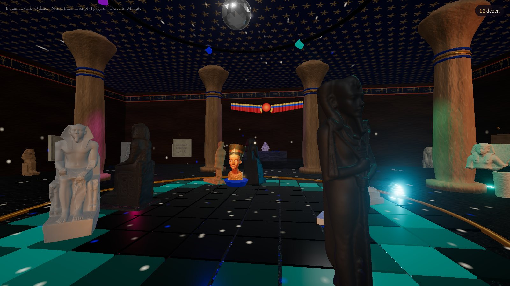
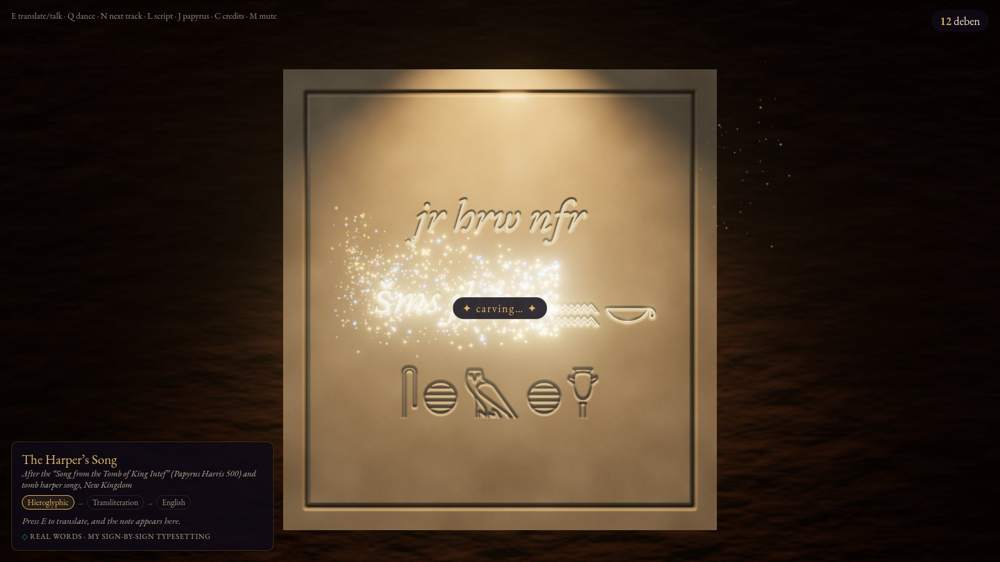
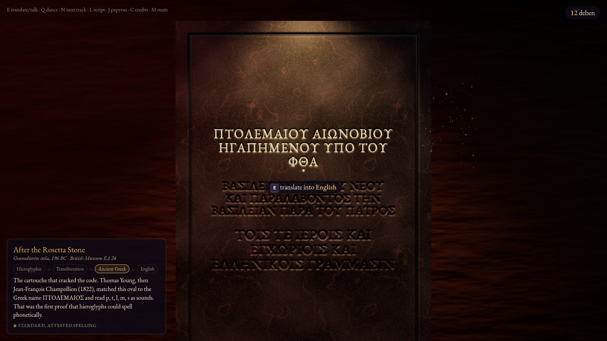
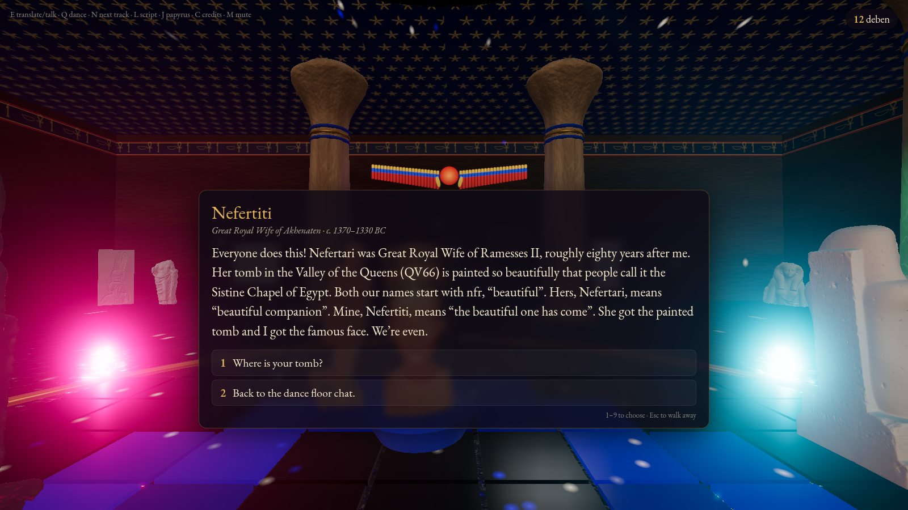
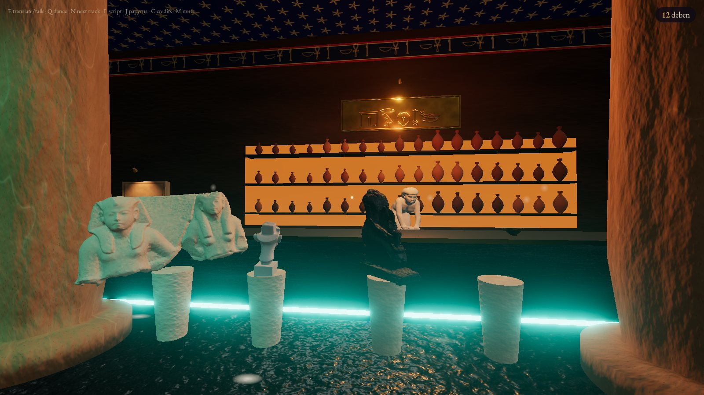
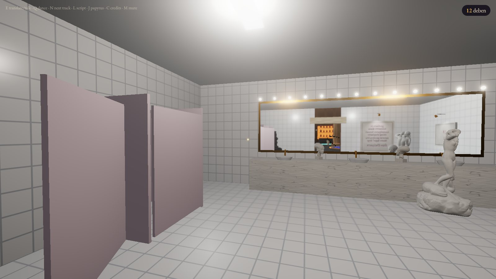

<div align="center">

# 𓉔𓂋𓅱𓇳𓄤𓆑𓂋
# CLUB HERU-NEFER

### *“The Good Day.” Ancient Egypt’s hottest nightclub. Est. c. 1350 BC. Reopened by popular demand.*

**Real statues. Real inscriptions. Real bad dancing.**

</div>



Ancient Egypt’s hottest club is **Heru-Nefer**. This place has *everything*: pharaohs who’ve been sitting
down since 2500 BC and are finally ready to get up, a priest trapped inside a block, a headless Aphrodite, a
floating Nefertiti who is *not* Nefertari, 7,000 jars of red beer, the oldest song in the world, and a bathroom
where someone has written Sappho on the stall.

Three thousand years of standing perfectly still, and they have *had it*. Tonight the statues dance.

Club Heru-Nefer is a walkable 3D nightclub that runs in your browser. The statues are **real 3D scans of real
museum pieces**. The walls are carved with **real ancient texts**, which you can translate line by line: look at
a line, press **E**, and watch the hieroglyphs dissolve in sparkles and re-carve themselves in English, with the
transliteration and the Greek alongside. Then go and bother Nefertiti on the dance floor. She has opinions.

Its name comes from the harpers’ songs: *jr hrw nfr*, “make holiday!” Egyptians carved that into their tombs.
We carved it over the bar.

---

## Tonight at the club

### 🗿 The dance floor
Seven scanned statues get down under disco lights, a mirror ball and ceiling lasers. There’s King Khafre with the
falcon wrapped around his head, Ramesses II, Thutmose III, Khonsu the moon god, Kaaper “the Village Headman”, a
priest trapped in a block statue doing his best, and a tiny wooden tomb figure blown up to human size. Stone
has no knees, so they hop, lean, spin and wobble. Press **Q** to dance with any of them. Every so often someone
wanders off for a drink, and a wallflower gets dragged back on.

### 𓂋 The walls talk


Every slab has its own low lamp, because carvings read best under **raking light**. That’s how Egyptologists
photograph them too. Each line is its own carved surface, and translating it wipes the new script across the
stone, re-carving it frame by frame. On the menu:

- **The Rosetta Stone**: Ptolemy’s cartouche, the one that cracked the code, plus the Greek line where the stone
  announces its own three scripts
- **The Harper’s Song**: *make holiday, follow your heart*
- **The offering formula**, the oldest menu in the world (bread, beer, oxen, fowl)
- **Hathor, Lady of Drunkenness**, patron saint of this establishment
- **Alcaeus’s drinking songs**: “Wine, dear boy, and truth”
- **The Song of Seikilos**, the oldest complete song on Earth. Translate it and a lyre plays it.
- **Sappho on the bathroom stall.** Obviously.



### 👑 Nefertiti


She floats on a lapis plinth in the middle of the floor, doing the head slide. The bust is the Neues Museum’s
own scan, in full colour, released in 2019 after a freedom-of-information campaign. Ask her about her missing
left eye, the sun disk, whether she secretly ruled Egypt as pharaoh (she won’t tell you), or why she’s in Berlin.
Do **not** call her Nefertari. Or do. She has a whole speech ready.

### 🍺 The bar


The barkeep is a servant statue who grinds grain for the afterlife’s bread and beer. She takes **deben**, a weight
of copper, because coins hadn’t been invented yet. You can order:

- barley beer
- Delta red wine
- **shedeh**, the prestige pour (a 2006 analysis finally proved it was red-grape wine)
- a blue-lotus spritz
- **Sekhmet’s Red**, beer dyed with red ochre. It’s on the house, as long as you promise not to destroy
  humanity.

Every drink makes the room wobble a bit more. King Ay and Queen Tey are on a date at the end of the bar.
Don’t stare.

### 💄 The girls’ bathroom


Bright white light, vanity bulbs, a real mirror, and the club music muffled through the wall. Aphrodite is
fixing her hair, and two Amarna princesses are gossiping on the counter. A tipsy statue will quote the
banqueting lady from the tomb of Paheri: *“Give me eighteen cups of wine!”* Someone has written Sappho on the
stall.

---

## The music

Every track is synthesised live in your browser with WebAudio: no samples and no copyrighted anything. Ask Hapi
the scribe (he’s DJing) what’s playing, or press **N** to skip.

| Track | Vibe | The story |
|---|---|---|
| **Heru-Nefer** | hijaz house, maqsum rhythm, 118 | the club anthem: *make holiday!* |
| **Opening of the Mouth** | acid techno, phrygian, 128 | the ritual that brought statues to life, which is why they can dance |
| **Sekhmet’s Red** | saidi rhythm, mizmar lead, 136 | 7,000 jars of red beer vs. one furious lioness goddess |
| **The Solar Barque** | melodic house, ney flute, 122 | the sun’s nightly cruise through the twelve hours of the underworld |
| **Festival of Drunkenness** | disco house, finger cymbals, 124 | Hathor’s festival: drink, pass out, get woken by drums |
| **While You Live, Shine** | the Seikilos song, deep house mix, 120 | the oldest complete song in the world, remixed |

Hapi will tell you himself that most of it is anachronistic. Maqam hijaz and the darbuka rhythms are much later
than pharaonic Egypt, and the kick drum is from 1980s Chicago. The sistrum, the finger cymbals, the lyre, and the
Seikilos tune are the ancient parts.

---

## Is any of this real?

**Yes, and it’s honest about the parts that aren’t.**

- **The statues are real scans.** There are 23 of them, from Berlin, Copenhagen, Geneva, Wikimedia Commons and
  the Smithsonian. About half are scans of **plaster casts** (the SMK Royal Cast Collection in Copenhagen), so
  they’re rendered white. Credits are below and in the game (press **C**).
- **The texts are real ancient texts.** Every translated line carries a fidelity badge:
  - ◆ **original**: Greek, quoted as preserved
  - ◆ **attested**: a standard, attested hieroglyphic spelling
  - ◇ **reconstructed**: real, attested words, but the sign-by-sign typesetting is ours and may differ from a
    specific monument
- **The English translations are ours**, and stay close to the standard scholarly ones.
- **The Seikilos melody is a loose approximation.** The club says so.
- **Nefertiti’s tomb still hasn’t been found.** She would like you to respect her privacy.

---

## Get in

It’s plain static files with no build step. Clone it and serve it:

```sh
git clone https://github.com/brezgis/ancient-club
cd ancient-club
python3 -m http.server 8000
# → http://localhost:8000
```

It works on **GitHub Pages** as is: Settings → Pages → deploy from `main`, root folder. Every path is relative.
Use a desktop browser (Chrome, Firefox or Safari). It needs a mouse and keyboard; there are no touch controls
yet.

| Key | Does |
|---|---|
| **W A S D** + mouse | walk & look (**Shift** to hurry) |
| **E** / click | translate a line into English (and back) · talk · order |
| **Q** | dance with a statue |
| **Space** | hop to the beat |
| **N** | next track |
| **J** | your papyrus: everything you’ve read |
| **C** · **M** | credits · mute |
| **H** | all of the above, in the club |

**On a laptop?** The club checks your GPU and picks a quality tier. Apple and Intel GPUs get the light version:
no shadows, no MSAA, and fewer live lights (both tiers render at up to 1.5× on retina screens, so text stays sharp). Add `?quality=low` or `?quality=high` to the URL to override.
If frames drop anyway, it steps down on its own.

---

## How the sausage is made (the sausage is limestone)

- **`src/glyphs.js`**: a tiny hieroglyph typesetter. It takes Manuel-de-Codage-style groups (`O4 D21:G43 N5`) and
  lays signs out in proper quadrats at their natural size, cartouches included. Gardiner codes map to Unicode
  through `src/gardiner.js`, which is generated from the Unicode character names.
- **`src/slab.js`**: the carving. Text is drawn as an ink mask, blurred into a height map (the sloped walls of
  sunk relief), and converted to a normal map for the raking light to catch. Translating wipes the new script
  across the old one, re-carving at 30 fps, with sparkles running along the edge.
- **`src/texts.js`**: every inscription, with notes and fidelity flags.
- **`src/characters.js`**: Nefertiti, Hapi, the barkeep, the dancers, and the girls in the bathroom.
- **`src/statues.js`**: loads the scans and makes rigid stone dance. It also runs the travel that lets
  statues hop-walk between the floor, the bar and the walls.
- **`src/audio.js`** + **`src/tracks.js`**: a small WebAudio sequencer with a worker clock, so the music keeps
  going when the tab is busy or in the background. Six tracks, each an arrangement of 8-bar sections.
- **`src/world.js`**: the architecture, the disco rig, the mirror ball, the lasers, and a **lamp pool**. The club
  has dozens of lamps but only a handful of real lights, handed to whichever lamps are nearest you. The walls are
  carved a slab at a time, yielding to the browser in between, so the loading card never freezes.
- **`src/cast.js`**: who plays whom, where everyone stands, and the social director that sends statues to the bar.
- **`src/mirror.js`**: the bathroom mirror, which only re-renders the room while you're near it.
- **`src/post.js`**: bloom, the wine wobble, MSAA, and a quality ladder that steps down if frames get slow.
- **`src/player.js`**, **`src/ui.js`**, **`src/main.js`**: you, the screen furniture, and the wiring.
- **`src/quality.js`**: GPU tiering.
- **`tools/shot.mjs`**: headless screenshots, used to make everything on this page.

The scans were simplified and meshopt-compressed with `gltfpack`, from 95 MB down to 4.8 MB. The raw and
full-resolution files aren’t in the repo. They start downloading the moment the page opens, while the walls are
still being carved. three.js is vendored minified (`vendor/three/*.min.js`, built from the npm package with esbuild).

---

## Credits

### 3D scans

| Object | License · source | |
|---|---|---|
| Bust of Nefertiti | CC BY-NC-SA 4.0 · © Staatliche Museen zu Berlin, Ägyptisches Museum und Papyrussammlung (scan: Trigon Art, 2008) | [link](https://www.thingiverse.com/thing:3974391) |
| Standing man: Kaaper, known as 'Sheikh el-Beled' (cast) | Public Domain Mark · SMK Royal Cast Collection | [link](https://open.smk.dk/artwork/image/KAS2366) |
| King Khafre (Chephren) Enthroned with the Horus Falcon (cast) | Public Domain Mark · SMK Royal Cast Collection | [link](https://open.smk.dk/artwork/image/KAS37) |
| Bakenkhons (Bek-en-Khons), prophet of Amun and master builder: block statue (cast) | Public Domain Mark · SMK Royal Cast Collection | [link](https://open.smk.dk/artwork/image/KAS805) |
| Kneeling woman grinding grain: servant statue (cast) | Public Domain Mark · SMK Royal Cast Collection | [link](https://open.smk.dk/artwork/image/KAS2228) |
| Head of a young queen (Nefertiti) (cast) | Public Domain Mark · SMK Royal Cast Collection | [link](https://open.smk.dk/artwork/image/KAS2224) |
| Head of an Amarna princess (cast) | Public Domain Mark · SMK Royal Cast Collection | [link](https://open.smk.dk/artwork/image/KAS2226) |
| Head of an Amarna princess (cast) | Public Domain Mark · SMK Royal Cast Collection | [link](https://open.smk.dk/artwork/image/KAS2225) |
| Stela with a kneeling king, possibly Taharqa ('Ethiopian stela') (cast) | Public Domain Mark · SMK Royal Cast Collection | [link](https://open.smk.dk/artwork/image/KAS1737) |
| Relief fragment: a queen (or daughter of Ramesses II) (cast) | Public Domain Mark · SMK Royal Cast Collection | [link](https://open.smk.dk/artwork/image/KAS1723) |
| Monumental statue of Sekhmet | CC BY-SA 3.0 FR · Rama, Wikimedia Commons | [link](https://commons.wikimedia.org/wiki/File:Sekhmet-MAHG_20926-High_poly-001.stl) |
| Seated statue of Ramesses II | CC BY-SA 3.0 FR · Rama, Wikimedia Commons | [link](https://commons.wikimedia.org/wiki/File:Ramesses_II-MAHG_8934-High_poly-001.stl) |
| Seated statuette of Nemtynakht | CC BY-SA 3.0 FR · Rama, Wikimedia Commons | [link](https://commons.wikimedia.org/wiki/File:Figurine_of_Nemtynakht-MAHG_26035-High_poly-001.stl) |
| Standing man figurine | CC BY-SA 3.0 FR · Rama, Wikimedia Commons | [link](https://commons.wikimedia.org/wiki/File:Standing_man_figurine-MAHG_23458-High_poly-001.stl) |
| Royal couple: King Ay and Queen Tey (upper bodies) | CC BY-SA 3.0 FR · Rama, Wikimedia Commons | [link](https://commons.wikimedia.org/wiki/File:Royal_couple-MAHG_12440-High_poly.stl) |
| Statuette of a princess (11th Dynasty) | CC BY-SA 3.0 FR · Rama, Wikimedia Commons | [link](https://commons.wikimedia.org/wiki/File:Princess-MAHG_4766-High_poly-001.stl) |
| Priest Hor-Neferibremen carrying a statuette of Osiris (fragmentary) | CC BY-SA 3.0 FR · Rama, Wikimedia Commons | [link](https://commons.wikimedia.org/wiki/File:Priest_Hor_Neferibremen_carrying_Osiris-Eg_9-High_poly.stl) |
| Aphrodite (Roman copy of a Hellenistic statue, headless) | CC BY-SA 3.0 FR · Rama, Wikimedia Commons | [link](https://commons.wikimedia.org/wiki/File:Aphrodite-MAHG_19025-High_poly-001.stl) |
| Statue of Hapi the scribe | CC BY-SA 4.0 · Omar El Atabany, Wikimedia Commons | [link](https://commons.wikimedia.org/wiki/File:Statue_of_Hapi_the_Scribe,_3D_photogrammetry_scan_(STL).stl) |
| Seated statue of King Thutmose III | CC BY-SA 4.0 · Omar El Atabany, Wikimedia Commons | [link](https://commons.wikimedia.org/wiki/File:Statue_of_King_Thutmose_III,_3D_photogrammetry_scan_(STL).stl) |
| Statue of the god Khonsu | CC BY-SA 4.0 · Omar El Atabany, Wikimedia Commons | [link](https://commons.wikimedia.org/wiki/File:Statue_of_Khonsu,_3D_photogrammetry_scan_(STL).stl) |
| Statue of Aphrodite with a dolphin | CC BY-SA 4.0 · Omar El Atabany, Wikimedia Commons | [link](https://commons.wikimedia.org/wiki/File:Statue_of_Aphrodite_with_dolphin,_3D_photogrammetry_scan_(STL).stl) |
| Kylix (two-handled drinking cup) | CC0 · Smithsonian 3D | [link](https://3d.si.edu) |

**Heads up:** the Nefertiti scan is **CC BY-NC-SA 4.0**, so this project is and must stay **non-commercial**.
The CC BY-SA scans are shared alike: the simplified versions in `assets/models/` are under the same licenses as
their sources. `assets/models/manifest.json` has full attribution, accession numbers, and notes for every piece.

### Everything else

- Hieroglyphs: [Noto Sans Egyptian Hieroglyphs](https://fonts.google.com/noto/specimen/Noto+Sans+Egyptian+Hieroglyphs) (SIL OFL)
- Greek & Latin: [EB Garamond](https://github.com/octaviopardo/EBGaramond12) (SIL OFL)
- Rendering: [three.js](https://threejs.org) (MIT)
- Texts: the Rosetta Stone (British Museum EA 24), the harpers’ songs, the offering formula, epithets of Hathor,
  Alcaeus fr. 332, 346, 366 and 333, the Seikilos epitaph, Sappho fr. 2 and 31, Greek graffiti from the Valley of
  the Kings, and Papyrus Chester Beatty I
- The code (everything in `src/`, `tools/`, `index.html`) is MIT-licensed. See [LICENSE](LICENSE).

<div align="center">

**𓋹 𓍑 𓋴**
*Life! Prosperity! Health! Now get on the dance floor.*

</div>
